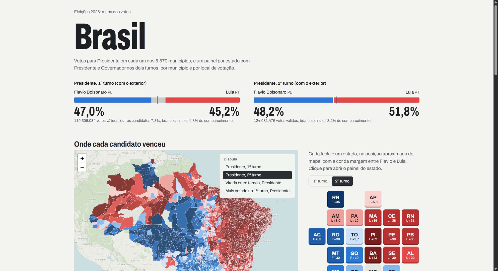

# Eleições 2026: mapa dos votos

Análise geográfica dos votos para **Presidente** e **Governador** nas eleições gerais de 2026, nos dois
turnos (4 e 25 de outubro), para o Brasil e cada um dos 27 estados — por município (por Região
Administrativa no DF) e por local de votação.



O site é estático e fica em [`docs/`](docs/). Para ver localmente:

```bash
make servir          # ou: cd docs && python3 -m http.server 8000
```

e abra http://localhost:8000.

## O que tem no site

- **Brasil** (`docs/index.html`): resultado nacional de Presidente nos dois turnos, mapa dos 5.570
  municípios (margem em cada turno, virada entre turnos, mais votado no 1º turno), teclado-cartograma
  com os 27 estados e tabela com Presidente e Governador por estado.
- **Cada estado** (`docs/<UF>/index.html`): resultados de Presidente e Governador, destaques em texto,
  mapa com seletor de disputa e de recorte (municípios ou locais de votação), gráficos de margem,
  de virada entre turnos, de voto casado Presidente × Governador e da composição do 1º turno, e a
  tabela de todos os municípios.

Margem é a diferença, em pontos percentuais dos votos válidos, entre os dois principais candidatos de
cada disputa: os finalistas do 2º turno ou, sem 2º turno, os dois mais votados. Nas cores, Presidente
usa azul para Flavio Bolsonaro e vermelho para Lula; Governador usa verde-água para o eleito (ou 1º
colocado) e laranja para o 2º colocado.

## Estrutura

```
docs/                  site gerado (GitHub Pages)
dados/
  geo/                 malhas do IBGE, RAs do DF e de-para de municípios TSE -> IBGE
  resumo/              indicadores por estado, município e local de votação (saída de preparar_dados.py)
scripts/
  baixar_base.py       malhas, de-para, locais de votação e candidatos
  baixar_1turno.py     votação por seção do 1º turno (dados abertos do TSE)
  baixar_bu_2turno.py  boletins de urna do 2º turno (decodifica o arquivo bu.dat, formato ASN.1/BER)
  preparar_dados.py    dados_brutos/ -> dados/resumo/
  gerar_mapas.py       dados/resumo/ + dados/geo/ -> docs/
  modelo_mapa.html     modelo dos mapas (Leaflet)
dados_brutos/          downloads (~2,7 GB), fora do git
```

## Como reproduzir

Requer Python 3.11+ e, de preferência, [uv](https://docs.astral.sh/uv/).

```bash
make ambiente   # cria .venv e instala requirements.txt
make site       # regenera docs/ a partir de dados/ (sem rede, ~40 s)
```

Para refazer tudo desde os dados do TSE:

```bash
make dados      # downloads para dados_brutos/ — o 2º turno leva algumas horas
make resumo     # dados_brutos/ -> dados/resumo/
make site
```

Os downloads podem ser interrompidos e retomados: rodar o mesmo comando de novo continua de onde parou.
`scripts/baixar_bu_2turno.py UF ...` baixa só alguns estados.

> **Atenção ao limite do TSE.** O servidor de resultados (`resultados.tse.jus.br`) bloqueia o IP por
> cerca de uma hora (HTTP 429) quando recebe requisições demais. O `baixar_bu_2turno.py` controla a
> taxa sozinho e pausa quando é bloqueado; não aumente o número de conexões.

## Fontes

| dado | origem |
|---|---|
| votação por seção do 1º turno | TSE, dados abertos: `votacao_secao_2026_<UF>.zip` (Governador) e `votacao_secao_2026_BR.zip` (Presidente) |
| votação por seção do 2º turno | TSE, boletins de urna em `resultados.tse.jus.br/oficial/ele2026/arquivo-urna/3221` (os dados abertos do 2º turno ainda não tinham sido publicados) |
| locais de votação e eleitorado | TSE, dados abertos: `eleitorado_local_votacao_2026.zip` |
| de-para de municípios TSE → IBGE | TSE, configuração da divulgação (`mun-e006257-cm.json`) |
| candidatos e situação (eleito, 2º turno) | [leofn/tse-candidatos-2026](https://github.com/leofn/tse-candidatos-2026), que reúne os dados de candidatos do TSE |
| malhas municipais e estaduais | IBGE, API de malhas |
| Regiões Administrativas do DF | IDE-DF/SEDUH (geoservicos.ide.df.gov.br) |

## Limitações

- Seções sem boletim publicado (agregadas a outras ou sem votação) não entram nos totais.
- A abstenção usa o eleitorado do cadastro de locais de votação do respectivo turno.
- O local de cada seção vem do cadastro do turno; o arquivo de votos às vezes traz o local original,
  anterior a remanejamentos. Locais sem coordenada válida ficam fora do mapa de pontos, mas contam nos
  totais do município.
- No DF, cada local é atribuído à RA que contém a sua coordenada.
- Municípios e RAs pequenos têm percentuais extremos; os destaques em texto priorizam áreas com 50 mil
  eleitores ou mais (10 mil no DF).
- Os votos do exterior entram apenas no total nacional de Presidente.
